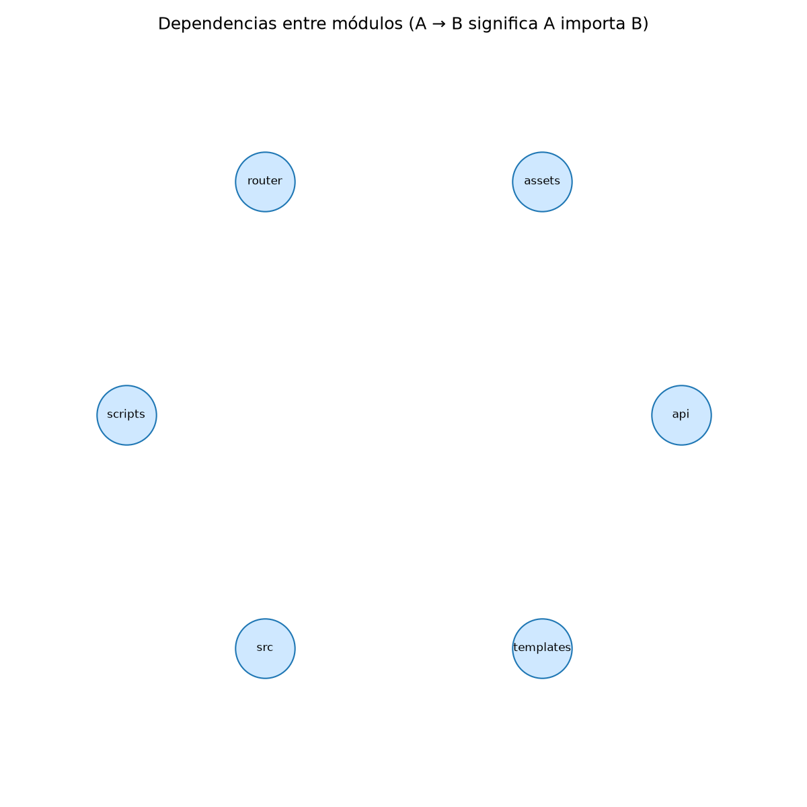

# mercaTECAM para quien llega por primera vez (nivel junior)

## 1. Qué hace este proyecto

mercaTECAM es una tienda en línea donde campesinos y asociaciones agroecológicas muestran sus productos: verduras, frutas, procesados y artesanías. Quien visita la página puede ver el catálogo, filtrar por categoría, buscar por nombre, abrir la ficha de un producto y armar un carrito. Todavía no hay pago ni pedidos: hoy llega hasta "armar el carrito" (historias HU-01 a HU-04).

## 2. Analogía

Piensa en una **plaza de mercado**:

- `api/index.php` es la **portería**: todo el que entra pasa por ahí y alguien le dice a qué puesto ir (`api/index.php:15-76`).
- `ProductRepository` es el **bodeguero**: es el único que sabe buscar en la bodega (la base de datos) y trae lo que le pidan (`src/ProductRepository.php:18`).
- Las plantillas de `templates/` son el **escaparate**: arman cómo se ve lo que trajo el bodeguero.
- `carrito.js` es la **canasta que lleva el cliente en la mano**: la guarda el propio navegador, no la tienda (`assets/js/carrito.js:36`).

## 3. Mapa de carpetas

| Carpeta o archivo | Para qué sirve |
|---|---|
| `api/index.php` | Único punto de entrada: decide qué hacer según la dirección (URL). |
| `router.php` | Hace lo mismo que Vercel pero en tu computador (`router.php:7-11`). |
| `vercel.json` | Le dice a Vercel: primero busca archivos estáticos, si no hay, manda todo a `api/index.php`. |
| `src/` | Código PHP reutilizable: arranque, conexión a la base, consultas y funciones de ayuda. |
| `templates/` | Páginas HTML con PHP incrustado (`layout.php`, `catalog.php`, partials). |
| `assets/` | Archivos estáticos: CSS, JavaScript (`carrito.js`), fotos de productos. |
| `database/schema.sql` | Estructura de las tablas (categorías, productores, productos). |
| `scripts/` | Comandos para la terminal: crear tablas e importar productos desde un CSV. |
| `data/` | Archivos CSV con los productos de origen y fotos. |

## 4. Cómo ejecutarlo

```bash
php scripts/migrar.php                               # crea las tablas (se puede repetir sin problema)
php scripts/importar_productos.php [csv] [fotosDir]  # carga productos desde un CSV
php -S localhost:8000 router.php                     # abre http://localhost:8000
php -l <archivo>                                     # revisa que un archivo PHP no tenga errores de sintaxis
```

Necesitas PHP 8 y una variable `DATABASE_URL` (en un archivo `.env` local) que apunte a una base PostgreSQL. No hay pruebas automáticas todavía.

## 5. Dónde empezar a leer

1. `api/index.php:5` y `api/index.php:15-76`: el arranque y las "ramas" por dirección.
2. `src/bootstrap.php:23-25`: qué archivos se cargan al inicio.
3. `src/ProductRepository.php:18`: cómo se piden los productos a la base.
4. `src/helpers.php:49`: cómo se arma una página (`render`).
5. `assets/js/carrito.js:77-104`: qué pasa al pulsar "Agregar al carrito".

## Vista general de módulos



*Limitación honesta: la herramienta de métricas (lizard) solo analizó 5 archivos y no detecta dependencias PHP hechas con `require`, así que esta imagen sale **sin flechas**. No significa que no haya relaciones. El mapa real se lee en [flujo-principal.md](flujo-principal.md).*

## Cierre

### Tres buenas prácticas que ya están en el código

1. **Consultas preparadas**: los datos del usuario nunca se pegan en el SQL, se pasan aparte (`src/ProductRepository.php:30-31`, y `EMULATE_PREPARES=false` en `src/Database.php:54-56`).
2. **Escapar antes de mostrar**: todo texto pasa por `e()` para que nadie inyecte HTML (`src/helpers.php:7`).
3. **Funciona sin JavaScript**: filtros y búsqueda son enlaces normales; el botón de agregar nace `disabled` y el JS lo activa (`templates/partials/boton-agregar.php:11`, `templates/layout.php:30`).

### Preguntas de comprobación

1. ¿Por qué el carrito no se guarda en la base de datos?
2. Si abres `/carrito`, ¿de dónde salen los nombres y precios que ves, si el navegador solo guardó ids y cantidades?

### Ejercicio

Agrega un campo opcional `origen_vereda` a un producto: añádelo en `database/schema.sql`, léelo en `ProductRepository::obtenerPorId` (`src/ProductRepository.php:66`) y muéstralo en la plantilla de la ficha. Después corre `php scripts/migrar.php` y `php -l` sobre cada archivo tocado.

### Respuestas

1. El equipo decidió que el carrito viva en el navegador (`localStorage`) porque aún no hay usuarios ni pedidos; ver [ADR-0002](../senior/adr/0002-carrito-en-navegador.md).
2. El JS pregunta nombres, precios y disponibilidad a `GET /api/carrito?ids=` (`assets/js/carrito.js:216`), y esa ruta sí consulta la base (`api/index.php:25-30`).
