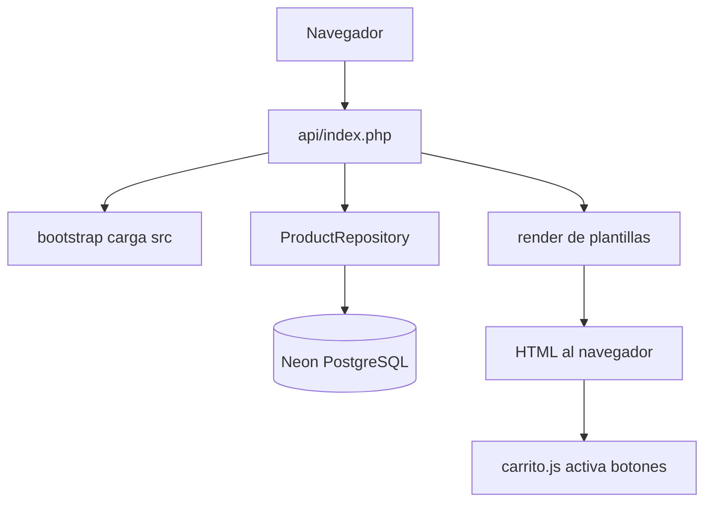
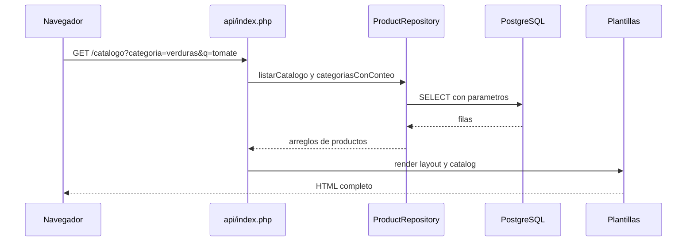
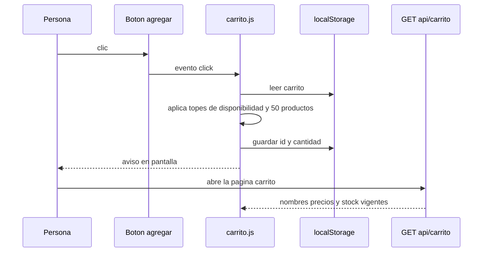

# Flujo principal: del clic a la página

Dos recorridos: ver el catálogo (`GET /catalogo`) y pulsar "Agregar al carrito".

## 1. Mapa del recorrido

*Hecho: toda petición pasa por `api/index.php` (`vercel.json`, bloque `routes`). `bootstrap.php` carga las clases (`src/bootstrap.php:23-25`).*
*Después de recibir el HTML, `carrito.js` (cargado con `defer`, `templates/layout.php:31`) activa los botones.*

## 2. Secuencia de `GET /catalogo`

*Los filtros llegan por la URL y se limpian con `query_param()` (`src/helpers.php:58`). La búsqueda ignora tildes y mayúsculas.*

## 3. Paso a paso

1. **Vercel recibe la petición** y, como no es un archivo estático, la reenvía a `api/index.php` (`vercel.json`; en local lo hace `router.php:7-11`).
2. **Arranque**: `require_once` de `src/bootstrap.php` (`api/index.php:5`), que lee `.env` si existe y carga las clases (`src/bootstrap.php:7-25`).
3. **Se leen los filtros** `categoria` y `q`, recortados a 40 y 100 caracteres (`api/index.php:11-12`).
4. **Se elige la rama**: para `/` o `/catalogo` entra al `if` de `api/index.php:43`.
5. **Se abre la conexión** (una sola por proceso, patrón singleton: `src/Database.php:12-16`) y se crea el repositorio (`api/index.php:44`).
6. **Se consultan los productos activos** con SQL preparado; el nombre se compara con `unaccent` e `ILIKE` (`src/ProductRepository.php:35`, `:47`).
7. **Se arma el HTML**: `render()` abre la plantilla con los datos (`src/helpers.php:49-55`), primero `catalog` y luego `layout` (`api/index.php:45-52`).
8. **Si algo falla**, el `catch` registra el error y muestra "No pudimos cargar el catálogo" (`api/index.php:84-94`).

## 4. Secuencia de "Agregar al carrito"

*Hecho: el botón trae `data-agregar`, `data-max` y `data-nombre` (`templates/partials/boton-agregar.php:7-9`) y está `disabled` hasta que el JS lo activa (`:11`).*
*El servidor no participa al agregar: solo se consulta cuando se abre la página del carrito.*

## 5. Paso a paso del botón

1. `activarBotones()` recorre los botones y les pone un manejador de clic (`assets/js/carrito.js:76`, `:80`).
2. Al hacer clic se lee el id, el máximo y la cantidad (1, o la del campo de la ficha) (`assets/js/carrito.js:81-88`).
3. Se lee el carrito guardado (`assets/js/carrito.js:16`). Si ya hay 50 productos distintos, se avisa y se detiene (`:92-95`).
4. La nueva cantidad se limita a la disponibilidad declarada (`:97`). Si no cambia, avisa que ya tienes todo (`:98-101`).
5. Se guarda solo `{id: cantidad}` en `localStorage` (`:102-103`; `guardar` está en `:36`).
6. Se actualiza el contador (`:53`) y se muestra un mensaje (`avisar`, `:66`).
7. En `/carrito`, el JS pide datos vigentes a `/api/carrito` (`cargar()`, `:262`, `fetch` en `:278`) y elimina productos agotados o retirados con un aviso (`:288-302`).

## 6. Qué pasa dentro de la página `/carrito`

1. **Mientras carga** se muestra "Cargando tu carrito…". Sin JavaScript ese texto queda oculto y solo se ve el aviso de activar JS (`templates/carrito.php:9`).
2. **Cuando llegan los precios**, el JS vuelve a leer el carrito guardado antes de depurarlo: si en otra pestaña agregaste algo mientras tanto, no se pierde (`assets/js/carrito.js:286-288`).
3. **Cada fila se actualiza en su lugar** (`pintar()`, `:223`; `actualizarItem()`, `:181`): al pulsar «+», «−» o «Quitar» no se redibuja toda la lista, así que quien usa teclado no pierde su posición y las fotos no se recargan.
4. **Al quitar un producto**, el foco pasa al producto vecino o al título (`quitar()`, `:160`). Escribir 0 en la cantidad también lo quita, y si escribes más de lo disponible se ajusta con un aviso (`cambiarCantidad()`, `:140`).
5. **El resumen** muestra cada producto con su cantidad × precio y el subtotal (`crearLineaResumen()`, `:203`), luego las unidades y el total.
6. **Otra pestaña u «Atrás»**: si el carrito cambia en otra pestaña (evento `storage`, `:356`) o el navegador restaura la página desde su caché al volver atrás (evento `pageshow`, `:364`), la lista y el total se actualizan.

## Cierre

### Buenas prácticas visibles aquí

1. Una sola puerta de entrada reduce los sitios donde olvidar una validación (`api/index.php:5`).
2. Al servidor solo se le aceptan hasta 50 ids, y solo números enteros completos: un id cortado o con letras se descarta en vez de convertirse en otro (`api/index.php:28-29`).
3. El precio nunca se confía al navegador: se vuelve a leer del servidor (`assets/js/carrito.js:278`).

### Pregunta de comprobación

Si un producto se agota mientras está en tu carrito, ¿qué ve la persona y quién se lo avisa? (Respuesta abajo.)

### Ejercicio

Cambia el límite de 50 productos distintos a 30. ¿En cuántos archivos tuviste que editar? (Pista: `api/index.php:29` y `assets/js/carrito.js:8`.) Anota qué problema te sugiere eso.

### Respuesta

El JS lo elimina del carrito al abrir `/carrito` y muestra un aviso (`assets/js/carrito.js:288-302`). El número 50 está repetido en PHP y JS sin vínculo entre ambos: es una deuda anotada en [deuda-tecnica.md](../senior/deuda-tecnica.md).
