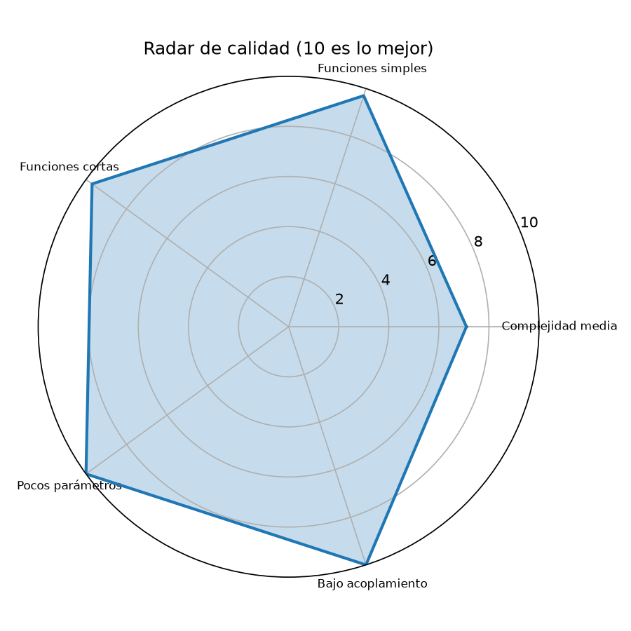
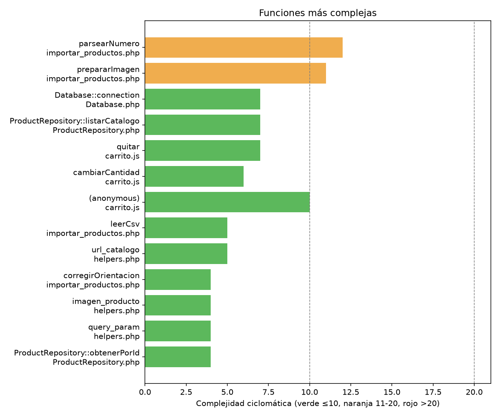

# Revisión de código limpio

## 1. Resumen y puntaje

| Fuente | Puntaje | Qué mide |
|---|---|---|
| Métricas (`../assets/metricas.json`, `puntaje_general`) | **9.3 / 10** | Complejidad, tamaño y ciclos entre módulos. |
| **Ajustado por lectura** | **8.0 / 10** | Añade lo que las métricas no ven. |

**Por qué se baja 1.3 puntos** (hechos): duplicación PHP/JS (`precio_cop` en `src/helpers.php:13` frente a `precio()` en `assets/js/carrito.js:48`); unas 105 líneas de script en ámbito global en el importador (`scripts/importar_productos.php:19-124`); estado oculto con `extract()` y parámetro por referencia `&$errores` (`src/helpers.php:51`, `scripts/importar_productos.php:216`); y ausencia de tests.

**Limitaciones de la medición** (hechos): lizard solo analizó 5 archivos; no detecta dependencias PHP por `require` (el grafo sale sin aristas, así que "sin ciclos" no es evidencia fuerte); reportó mal los parámetros de `prepararImagen` (1 en vez de 6). Cifras disponibles (regeneradas tras el commit `5593565`): 68 funciones, CCN medio 2.88, 2 funciones con CCN > 10, 2 con NLOC > 40. El puntaje se mantiene en 9.3.

*El radar viene de las métricas automáticas (9.3), no del puntaje ajustado.*

## 2. Hallazgos priorizados

Formato: severidad | archivo:línea | principio | por qué importa | propuesta.

### Alta

- alta | `scripts/importar_productos.php:19-124` | SRP, testabilidad | ~105 líneas globales mezclan lectura, validación, SQL y fotos; no se puede probar sin ejecutar todo (las funciones se declaran después del `exit`) | dividir en funciones y un `main` (ver refactor 5).
- alta | `scripts/importar_productos.php:216` | SRP, parámetro de salida | `prepararImagen` tiene 6 parámetros incluido `&$errores`, CCN 11, anidamiento; si `imagecreatefrom*` devuelve false cae a `copy` sin aviso (hecho según el informe de revisión; la rama sin GD de `:255-258` sí avisa del peso de la foto) | devolver `{ruta, avisos}` (refactor 4).
- alta | `scripts/importar_productos.php:75-118` | Robustez | las fotos se escriben dentro de la transacción y no hay `try/catch` con `rollBack` (verificado: el script no tiene ninguno) | refactor 5.

### Media

- **resuelto** | `src/ProductRepository.php:19-25` | DRY | los casteos de tipos estaban copiados en tres métodos | aplicado: `hidratar()` (refactor 2, commit `5593565`). Queda aparte el conteo de `categoriasConConteo` (`:157`), que tipa otro campo.
- media | `api/index.php:16`, `:30`, `:44`, `:59` | DRY | `new ProductRepository(Database::connection())` en 4 ramas; en `/carrito` no hace falta conexión | repositorio perezoso (refactor 1).
- media | `assets/js/carrito.js:80-107` | SRP | el manejador de clic lee DOM, valida, calcula, guarda y avisa (CCN 10) | función pura `calcularAgregado` (refactor 3).
- media | `assets/js/carrito.js:112-348` | Tamaño | `iniciarPaginaCarrito` creció a ~237 líneas al agregar sincronización entre pestañas, `bfcache` y actualización de filas en su lugar; ya está dividida en funciones internas (`cargar` `:262`, `pintar` `:223`, `actualizarItem` `:181`, `crearLineaResumen` `:203`), pero todas comparten el mismo cierre | mover la página del carrito a su propio archivo o módulo y probar `cargar`/`pintar` por separado.
- media | `src/helpers.php:49-51` | Estado oculto | `extract()` deja la plantilla ver `$template` y `$vars` | pasar un array explícito o documentar variables esperadas en cada plantilla.
- media | `api/index.php:87-94` | Cohesión | HTML de error embebido en el controlador; el mensaje "No pudimos cargar el catálogo" aparece aunque falle otra ruta | plantilla de error con mensaje genérico.
- media | `src/helpers.php:13` frente a `assets/js/carrito.js:48` | DRY entre lenguajes | formatear COP en PHP y en JS (`Intl es-CO`) puede redondear distinto (hipótesis) | prueba de contraste con valores límite; si no, devolver el texto formateado desde el servidor.
- media | `src/Database.php:12` | SRP | `connection()` con ~41 NLOC y CCN 7 mezcla parseo de URL, opciones de Neon y PDO | extraer `dsnDesdeUrl()` (`:44-47` es el bloque de Neon).

### Baja

- baja | `api/index.php:29` y `assets/js/carrito.js:8` | Números mágicos | el 50 está repetido sin vínculo | documentar y probar que ambos coinciden, o exponerlo desde `/api/carrito`.
- **resuelto** | `src/ProductRepository.php:7` | Números mágicos | `2147483647` estaba duplicado | aplicado: constante `ID_MAXIMO` y `idValido()` (`:13-16`).
- baja | `scripts/importar_productos.php:95-96` | Claridad | `?? null ?: null` es difícil de leer y trata "0" como vacío | `vacioANulo()` (refactor 6).
- baja | `scripts/importar_productos.php:177` | Heurística sin tests | `parsearNumero` decide qué es "1.500" (miles o decimal) | tests de tabla.
- baja | `scripts/importar_productos.php:258` | Número mágico | `300*1024` | constante nombrada.
- baja | `router.php:7` | Defensivo | `$_SERVER['REQUEST_URI']` sin `?? '/'`, a diferencia de `api/index.php:7` | añadir el valor por defecto.
- baja | varios | Convención | mezcla de snake_case (helpers) y camelCase (métodos) | decidir y documentar.
- baja | plantillas de catálogo, ficha y carrito | DRY | la regla "agotado" se repite en 3 plantillas | un helper o parcial.

## 3. Complejidad: tres casos críticos

*Gráfica generada por lizard sobre 5 archivos; lo que no se midió no está en la gráfica.*

1. **`parsearNumero`** (`scripts/importar_productos.php:177`, CCN 12): complejidad esencial, no accidental, porque debe interpretar formatos colombianos de números ("12.500", "$12,500", "12.500,50", "3,5"). Está documentada, pero sin tests no se puede refactorizar con confianza. Prioridad: añadir una tabla de casos antes de tocarla.
2. **`prepararImagen`** (`scripts/importar_productos.php:216`, CCN 11): cascada de responsabilidades (URL o archivo local, decodificar, orientar, redimensionar, comprimir, escribir). Hay un bug latente: si la decodificación devuelve false, se copia el archivo sin avisar.
3. **Manejador de clic** (`assets/js/carrito.js:80-107`, CCN 10): cuatro responsabilidades en una función anónima. Es el mejor candidato a función pura porque sus reglas (tope de 50, tope de disponibilidad) son lo más probable que se rompa.

## 4. Lo que está bien hecho

- **Seguridad básica sólida**: consultas preparadas, escape de LIKE, `e()` en salida (`src/ProductRepository.php:47-48`, `src/helpers.php:7`, `src/Database.php:54-56`).
- **Entradas defendidas**: id validado con regex y rango (`api/index.php:58`, `src/ProductRepository.php:13-16`); `/api/carrito` solo acepta ids enteros completos (`api/index.php:28-29`); `query_param` con límite de longitud (`src/helpers.php:58`).
- **Carrito prudente**: guarda solo `{id: cantidad}`, fallback en memoria si el almacenamiento está bloqueado, sincroniza lista y total entre pestañas y al volver con «Atrás» (`assets/js/carrito.js:16`, `:36`, `:356`, `:364`).
- **Accesibilidad del carrito**: las filas se actualizan en su lugar y el foco se reubica al quitar (`assets/js/carrito.js:160-172`, `:250`); «−»/«+» usan `aria-disabled` para no perder el foco; el contador se anuncia desde el enlace (`assets/js/carrito.js:60-62`).
- **Disciplina de tipos**: `strict_types` y clases `final` (`src/Database.php:4`, `src/ProductRepository.php:4`, `declare` en la línea 2 de cada archivo de `src/`).
- **Importador operable**: idempotente con `ON CONFLICT`, tolera BOM y Windows-1252, y usa códigos de salida 0/1/2.
- **Progressive enhancement** (`templates/partials/boton-agregar.php:11`).
