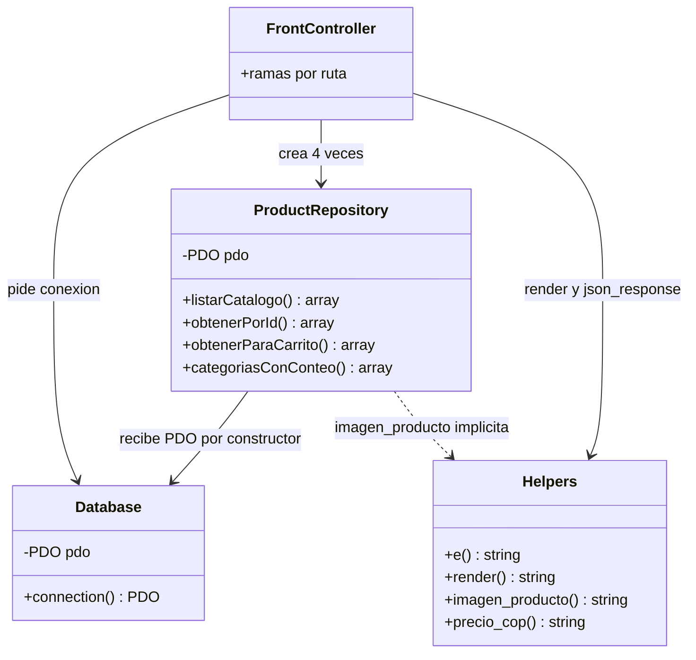

# Patrones y principios detectados

Convención: **Hecho** = visto en el código; **Hipótesis** = inferido. Lo que no queda claro se dice así.

## Mapa de clases y colaboraciones

*Hecho: la línea punteada es una dependencia implícita de la capa de datos hacia la de presentación (`src/ProductRepository.php:131` llama a `imagen_producto()`, definida en `src/helpers.php:19`).*
*`FrontController` no es una clase: es el script `api/index.php`. Se dibuja así solo para ver la colaboración.*

## 1. Front Controller

- **Dónde**: `api/index.php:5-91`; `vercel.json` (`handle: filesystem` y reescritura) y `router.php:7-11` lo reproducen en local.
- **Problema que resuelve**: Vercel expone una sola función PHP; un único punto concentra el arranque, el manejo de errores (`api/index.php:81-91`) y la selección de ruta.
- **Alternativa**: un archivo PHP por página, o un micro-router/framework. No se eligió por el límite de una función en Vercel y por la decisión de no usar framework (ver [ADR-0001](../senior/adr/0001-front-controller-unico.md) y [ADR-0003](../senior/adr/0003-php-sin-framework-ni-composer.md)).
- **Coste**: cada ruta nueva es otro `if` (`api/index.php:15`, `:25`, `:32`, `:40`, `~:58`); crece contra el Open/Closed.

## 2. Repository

- **Dónde**: `src/ProductRepository.php:6` (constructor con `PDO`), métodos en `:18`, `:66`, `:113`, `:146`.
- **Problema**: aislar SQL de las vistas y compartir la misma consulta entre la página HTML y el JSON (`api/index.php:15-20` y `:40-49` usan `listarCatalogo`).
- **Alternativa**: SQL directo en las plantillas, o un ORM. No queda claro si un ORM se evaluó; con "sin Composer" quedaba descartado en la práctica (hipótesis).
- **Matiz**: un repositorio devuelve arrays, no entidades; es un repositorio sobre un modelo anémico (ver [dominio-ddd.md](../senior/dominio-ddd.md)).

## 3. Singleton con inyección compensatoria

- **Dónde**: `src/Database.php:6` (`private static ?PDO`), `:12` y `:14-16`.
- **Problema**: reutilizar una conexión por petición, algo que importa con Neon (cada conexión nueva cuesta).
- **Alternativa**: crear el PDO en cada repositorio, o un contenedor de dependencias. El repositorio recibe el PDO por constructor (`src/ProductRepository.php:6`), lo que lo hace testeable aunque el singleton no lo sea. Mitigación razonable.

## 4. Template View (render con extract)

- **Dónde**: `src/helpers.php:49-55`, `extract` en `:51`.
- **Problema**: componer HTML sin motor de plantillas, con buffer de salida y plantillas anidadas (`api/index.php:42-49`).
- **Alternativa**: Twig/Blade (requieren Composer). Riesgo conocido: `extract` deja visibles `$template` y `$vars` dentro de la plantilla; `EXTR_SKIP` evita pisar variables existentes pero oculta de dónde sale cada variable.

## 5. Validación en el borde y consultas parametrizadas

- **Dónde**: `query_param()` recorta y normaliza (`src/helpers.php:58-66`); id acotado a rango INTEGER (`src/ProductRepository.php:66-69`, `:113-115`); LIKE escapado con `addcslashes` (`src/ProductRepository.php:30-31`); PDO sin emulación (`src/Database.php:54-56`).
- **Problema**: evitar inyección SQL, comodines accidentales y un 500 por ids fuera de rango.
- **Alternativa**: confiar en el motor para rechazar. Se eligió defender en la capa de aplicación; el beneficio es devolver 404 en lugar de 500.

## 6. Progressive Enhancement

- **Dónde**: filtros como enlaces con `url_catalogo()` (`src/helpers.php:69`); botón `disabled` hasta que el JS lo activa (`templates/partials/boton-agregar.php:11`); `carrito.js` con `defer` (`templates/layout.php:30`).
- **Problema**: que el catálogo funcione sin JS y que el carrito no dependa del servidor para agregar.
- **Alternativa**: SPA. No se eligió: no hay build ni framework JS.

## 7. Estado en el cliente con reconciliación en el servidor

- **Dónde**: guarda solo `{id: cantidad}` (`assets/js/carrito.js:36`), lee con fallback (`:16`), pide datos vigentes (`:216`), depura agotados (`:224-236`), sincroniza pestañas (`:244`).
- **Problema**: carrito sin usuarios ni sesión.
- **Alternativa**: carrito en sesión PHP o en tabla. Ver [ADR-0002](../senior/adr/0002-carrito-en-navegador.md). Los totales y topes solo se garantizan en JS; el servidor solo recorta a 50 ids (`api/index.php:26`).

## 8. Upsert idempotente (Transaction Script)

- **Dónde**: `scripts/importar_productos.php:19-124` (script global), transacción en `:75` y `:118`.
- **Problema**: poder reimportar el CSV sin duplicar (UNIQUE en `database/schema.sql:32`).
- **Alternativa**: INSERT simple con borrado previo (pierde ids) o comandos separados. No queda claro si se pesó; el coste es un script difícil de testear (ver [refactors.md](refactors.md)).

## Lo que no se aplicó (y conviene saberlo)

- **Hecho**: no hay capa de servicio/casos de uso; el controlador llama al repositorio directamente (`api/index.php:41-43`).
- **Hecho**: no hay interfaces para el repositorio; no hay inversión de dependencias formal.

## Mini reto

Elige el patrón 2 y dibuja en papel cómo cambiaría el diagrama si `ProductRepository` devolviera un objeto `Producto` en lugar de arrays. Después revisa [refactors.md](refactors.md) y marca qué refactor te acerca a eso.

## Tabla de esfuerzo

| Refactor sugerido por esta lectura | Esfuerzo | Beneficio |
|---|---|---|
| Cortar dependencia repo a helpers (`imagen_producto`) | S | Capas limpias, repo testeable |
| Repositorio único perezoso en el front controller | S | Menos duplicación, no conecta en `/carrito` |
| Extraer rutas a tabla o archivo por ruta | M | Cumple Open/Closed |

Detalle en [refactors.md](refactors.md).
