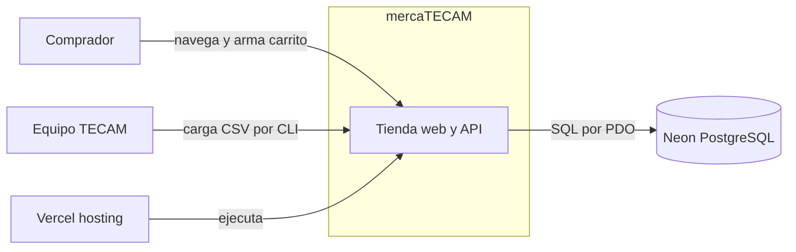
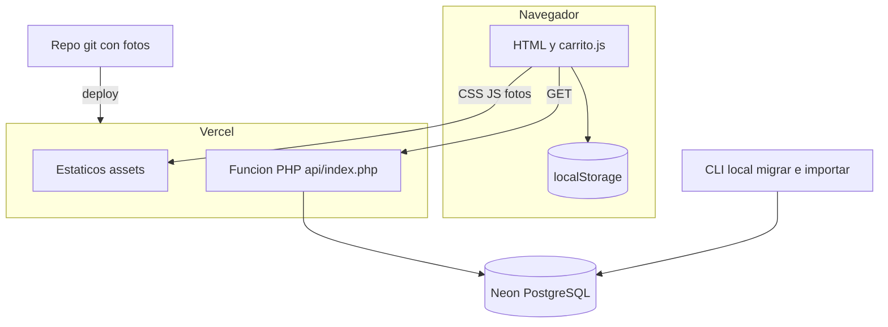
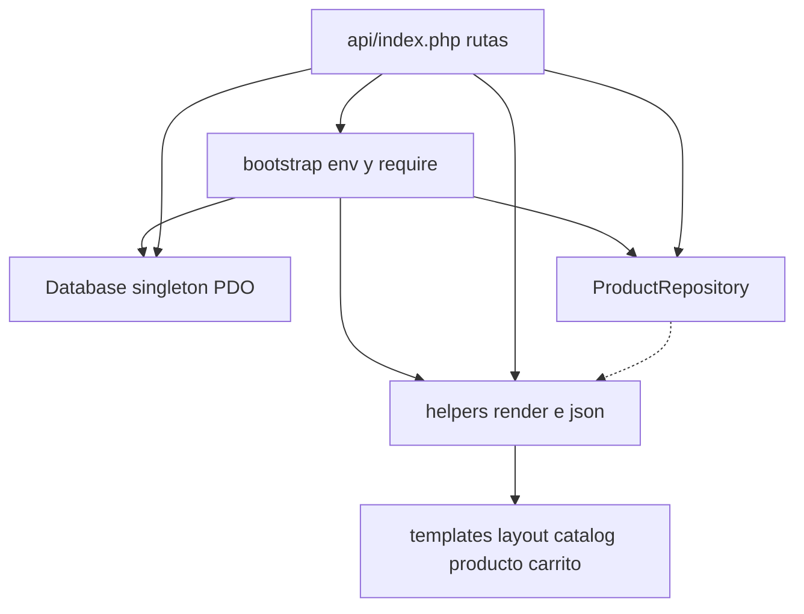
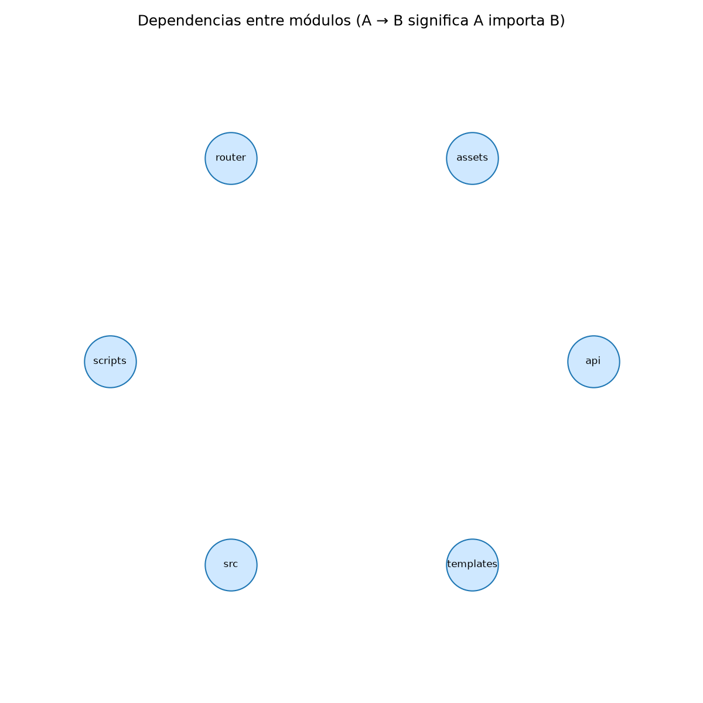

# Arquitectura (C4)

Estilo: monolito PHP en capas simples: front controller, repositorio sobre PDO y vistas PHP del lado del servidor, con transaction script en el controlador. **Hechos** vienen con `archivo:línea`; las **hipótesis** se marcan.

## Nivel 1: contexto

*Hecho: el comprador usa solo lectura y carrito local; no hay login ni checkout (`api/index.php:15-79` no tiene rutas de pedido).*
*El equipo carga productos con `scripts/importar_productos.php` desde su máquina, no desde la web. Vercel y Neon son externos.*

## Nivel 2: contenedores

*Hecho: `vercel.json` sirve primero el sistema de archivos y reescribe todo lo demás a `api/index.php`; `router.php:7-11` hace lo mismo en local.*
*Hecho: las fotos están versionadas en `assets/productos/` y viajan con el deploy; el CLI escribe directamente en la base (`scripts/importar_productos.php:75-118`).*
*Hipótesis: la CLI se ejecuta contra la misma base Neon de producción; no hay evidencia de un entorno de staging.*

## Nivel 3: componentes de la función PHP

*Hecho: `bootstrap.php` carga las clases con `require_once` (`src/bootstrap.php:23-25`); `render` abre plantillas (`src/helpers.php:49-55`).*
*La flecha punteada es la dependencia invertida: el repositorio llama a `imagen_producto()` de los helpers (`src/ProductRepository.php:138`, `src/helpers.php:19`).*
*Hecho: los scripts de CLI también reutilizan `bootstrap.php`.*

## Propiedades de calidad

| Propiedad | Qué hay (hechos) | Qué falta |
|---|---|---|
| Escalabilidad | Función serverless sin estado; carrito en el cliente (`assets/js/carrito.js:36`); conexión reutilizada por proceso (`src/Database.php:14-16`) | Sin paginación ni caché en `listarCatalogo` (`src/ProductRepository.php:35`); `unaccent(...) ILIKE '%...%'` (`:47`) no usa índice y escanea la tabla. Hipótesis: un índice trigram ayudaría si el catálogo crece |
| Resiliencia | `try/catch Throwable` global (`api/index.php:84-94`); fallback en memoria del carrito (`assets/js/carrito.js:16`); imágenes con `onerror` (`templates/partials/product-card.php:9`) | Mensaje de error de catálogo para cualquier ruta; sin reintentos ni health check; sin plan ante caída de Neon |
| Seguridad | Consultas preparadas (`src/ProductRepository.php:47-48`, `src/Database.php:54-56`), escape `e()` (`src/helpers.php:7`), ids validados (`src/ProductRepository.php:13-16`, `api/index.php:28-29`) | Integridad del carrito solo en cliente; sin cabeceras de seguridad ni límite de tasa visibles. **Hipótesis a verificar en el despliegue**: si `/src/Database.php` o `/data/productos.csv` quedan accesibles como estáticos por `handle: filesystem` |
| Observabilidad | `error_log('[mercaTECAM] ...')` con el mensaje (`api/index.php:85`) | Sin trazas, métricas ni identificador de petición; no se registra la ruta |
| Mantenibilidad | Clases `final` y `strict_types` (`src/Database.php:4`) | Sin tests ni CI; migraciones por `schema.sql` sin versionado (`database/schema.sql`) |

## Acoplamiento

*Limitación: lizard analizó 5 archivos y no detecta dependencias PHP por `require`; la imagen sale **sin aristas** y no sirve para concluir nada sobre ciclos.*

Lectura manual del grafo (hecho, por lectura de los `require`): router → index → bootstrap → {Database, ProductRepository, helpers}; scripts → bootstrap; index → plantillas vía `render`; catalog → product-card → boton-agregar; producto → boton-agregar; layout → styles.css y carrito.js; carrito.js → `GET /api/carrito`. **No se observan ciclos de require.** Única dependencia invertida: `ProductRepository` a `helpers` (`src/ProductRepository.php:138`).

Si el equipo añade composer o autoloading más adelante, este es el punto a vigilar ([ADR-0003](adr/0003-php-sin-framework-ni-composer.md)).

## Decisiones relacionadas

[0001](adr/0001-front-controller-unico.md), [0002](adr/0002-carrito-en-navegador.md), [0003](adr/0003-php-sin-framework-ni-composer.md), [0004](adr/0004-estaticos-fuera-de-la-funcion.md), [0005](adr/0005-busqueda-unaccent-ilike.md), [0006](adr/0006-precio-referencia-y-disponibilidad-declarada.md).

## Decisiones abiertas para debatir

1. **Escala de la búsqueda**: (a) mantener `unaccent ILIKE`; (b) índice trigram; (c) búsqueda de texto completo. Criterio: tamaño del catálogo y latencia medida en Neon; hoy no hay medición (pendiente de confirmar).
2. **Entorno y despliegue**: (a) una sola base compartida entre local y producción; (b) rama de Neon por entorno. Criterio: riesgo aceptable al importar CSV contra datos reales.
