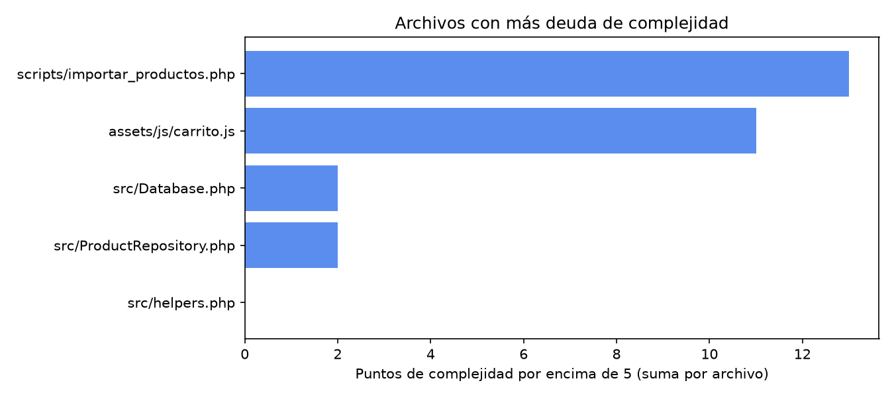

# Deuda técnica priorizada

Convención: hecho = visto en código; hipótesis = marcada. Esfuerzo S (horas), M (días), L (semanas). Los esfuerzos son estimaciones del autor, no mediciones.

*Limitación: lizard analizó solo 5 archivos, así que la gráfica no cubre plantillas ni todo `src/`. Úsala como orientación, no como inventario.*

## Tabla priorizada

| # | Deuda | Evidencia | Impacto | Esfuerzo | Riesgo si se ignora | Prioridad |
|---|---|---|---|---|---|---|
| 1 | Sin tests ni CI | No hay suite (`php -l` es lo único) | Cualquier refactor es a ciegas | M | Regresiones en reglas del carrito y del importador | Alta |
| 2 | Invariantes del carrito solo en cliente | `assets/js/carrito.js:80-107`, `:140-158`; servidor solo recorta a 50 ids (`api/index.php:28-29`) | Tope y totales evitables desde la consola del navegador | M | Pedidos incorrectos cuando llegue el checkout | Alta |
| 3 | Importador: script global sin atomicidad clara | `scripts/importar_productos.php:19-124`, transacción `:75-118` | Intestable; fallos a mitad de lote dejan fotos huérfanas | M | Datos de catálogo corruptos o importaciones difíciles de depurar | Alta |
| 4 | `prepararImagen` con 6 parámetros y fallo silencioso | `scripts/importar_productos.php:216` | Fotos mal procesadas sin aviso | M | Imágenes rotas o pesadas en producción | Media |
| 5 | Duplicación PHP y JS (formato COP, textos de disponibilidad, tope 50) | `src/helpers.php:13` frente a `assets/js/carrito.js:48`; `api/index.php:29` frente a `assets/js/carrito.js:8` | Divergencias de redondeo o de reglas | S | Mensajes y totales inconsistentes | Media |
| 6 | Repositorio instanciado en cada ruta (los casteos ya se unificaron en `hidratar()`, commit `5593565`) | `api/index.php:16`, `:30`, `:44`, `:59` | Cambiar la construcción exige tocar cuatro sitios; `/carrito` no la necesita | S | Conexiones innecesarias | Baja |
| 7 | Búsqueda sin índice, sin paginación ni caché | `src/ProductRepository.php:47`, `:35` | Latencia al crecer el catálogo (hipótesis: no medida) | M | Degradación en Neon por escaneos completos | Media |
| 8 | Repositorio depende de helpers (capa de datos a presentación) | `src/ProductRepository.php:138` | Acoplamiento oculto; solo `/api/carrito` normaliza imagen | S | Imágenes distintas en `/api/productos` y `/api/carrito` | Media |
| 9 | Manejo de errores genérico y observabilidad pobre | `api/index.php:84-94` | Mensaje "No pudimos cargar el catálogo" para cualquier ruta; log sin ruta | S | Diagnóstico lento de incidentes | Media |
| 10 | Migraciones por `schema.sql` sin versionado | `database/schema.sql` | No hay historial ni rollback de cambios | M | Cambios de esquema difíciles de coordinar | Media |
| 11 | Fotos binarias versionadas en git | `assets/productos/` (decisión: `CLAUDE.md`) | Repo que crece | M | Clones lentos con cientos de fotos | Baja |
| 12 | `extract()` y helpers mezclados (render, HTTP, formato) | `src/helpers.php:49-51`, `:75` | Variables implícitas en plantillas | M | Errores difíciles de rastrear | Baja |
| 13 | Números mágicos y heurísticas | `300*1024` (`scripts/importar_productos.php:258`), `parsearNumero` (`:177`) | Cambios sin contexto | S | Fallos sutiles al ajustar | Baja |
| 14 | Hipótesis de exposición de archivos | `vercel.json` (`handle: filesystem`) con `/src` y `/data` en el repo | Posible lectura de `src/Database.php` o `data/productos.csv` como estáticos | S | Fuga de información, si se confirma | **Verificar ya** |

## Plan sugerido en 3 etapas

**Etapa 1: ganancias rápidas (1 a 2 semanas)**
- Verificar la hipótesis 14 pidiendo `/src/Database.php` y `/data/productos.csv` en el despliegue; si responde, excluir esas carpetas.
- Refactors 1, 2 y 6 de [refactors.md](../middle/refactors.md); constante `ID_MAXIMO`; mensaje de error por ruta con log que incluya `$path`.
- Corregir el comentario de 4 categorías (`scripts/importar_productos.php:10-12`).

**Etapa 2: estructural (1 a 2 meses)**
- Primeros tests: tabla de `parsearNumero`, `calcularAgregado`, y pruebas de humo contra una base Neon de rama.
- Reestructurar el importador (refactores 4 y 5) y añadir CI con `php -l` y los tests.
- Mover `imagen_producto` fuera del repositorio; separar helpers en archivos por responsabilidad.
- Migraciones numeradas.

**Etapa 3: estratégica (trimestre)**
- Decidir [ADR-0006](adr/0006-precio-referencia-y-disponibilidad-declarada.md) antes de construir checkout.
- Reglas del carrito en servidor, value objects (PrecioCOP, Cantidad) y reservas de inventario según la respuesta de negocio.
- Evaluar índice trigram y paginación si hay medición que lo justifique.

## Puntaje

Métricas automáticas: 9.3. Ajustado por lectura: 8.0. La diferencia está en los puntos 1, 3 y 5 (sin tests, script global del importador, duplicación PHP/JS) y en el estado oculto (`extract`, `&$errores`), que lizard no ve.
