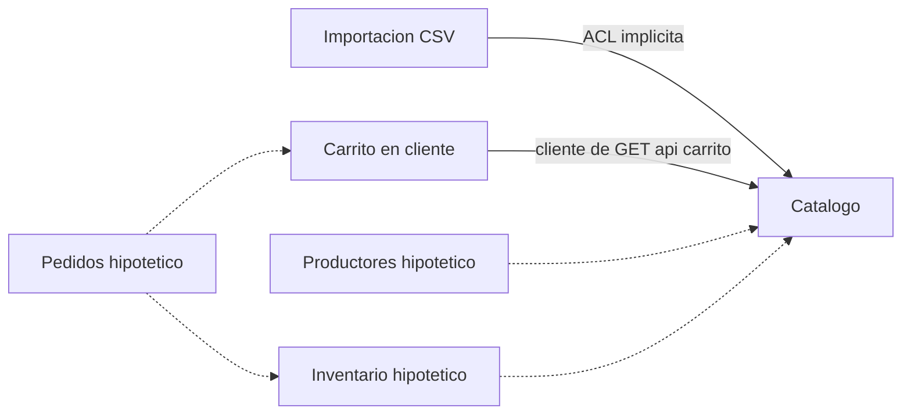
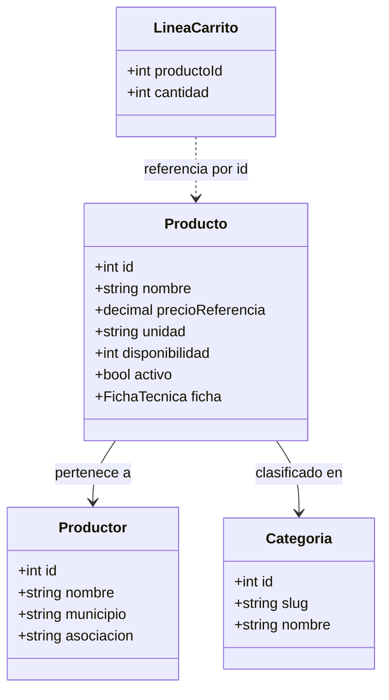

# Dominio (DDD)

**Diagnóstico corto**: modelo anémico. No hay clases de dominio; el modelo vive en `database/schema.sql` y en las consultas de `src/ProductRepository.php`, y los datos viajan como arrays. Para el tamaño actual (catálogo y carrito sin pedidos) es razonable; el problema aparece cuando llegue el checkout.

## Bounded contexts y mapa de contextos

*Existen hoy tres contextos (líneas continuas): Catálogo, Carrito (vive en `assets/js/carrito.js`, lee de Catálogo por `/api/carrito`, `api/index.php:25-33`) e Importación (traduce el Excel al modelo).*
*Los contextos con "hipotetico" y las líneas punteadas son **propuesta**, no existen en el código.*
*Hecho: la importación actúa como capa anticorrupción implícita: convierte "Precio Estimado (COP)" y "Presentación" en `precio_referencia` y `unidad` (ver encabezados en `data/productos.csv` frente a `data/productos_importar.csv`).*

**Hipótesis** sobre la carga de datos: el Excel real (`data/productos.csv`, encabezados "Item", "Foto / Archivo", "Nombre del Producto", "Descripción y Características", "Origen / Productor", "Presentación", "Precio Estimado (COP)") se transforma a mano a `data/productos_importar.csv` (`nombre;categoria;precio_referencia;unidad;disponibilidad;productor;municipio;asociacion;imagen;descripcion;...`). Faltan en el Excel real `categoria`, `disponibilidad` y `municipio`; quién los completa y cómo no está documentado (pendiente de confirmar).

## Modelo de entidades y valores

*Hecho: las tablas `categorias`, `productores` y `productos` existen (`database/schema.sql:9`, `:15`, `:32`); `FichaTecnica` y `LineaCarrito` son **conceptos propuestos**: hoy son columnas de texto (`database/schema.sql:38-40`) y un mapa `{id: cantidad}` (`assets/js/carrito.js:36`).*
*`Producto` tiene identidad (id) y clave natural (nombre + productor, `database/schema.sql:32`).*

## Agregados e invariantes

Agregado candidato: **Producto** (raíz) con Ficha técnica y referencias a Productor y Categoría. Productor y Categoría son agregados propios.

| Invariante | Dónde se cumple hoy (hecho) | Observación |
|---|---|---|
| Precio de referencia >= 0 | CHECK (`database/schema.sql:25`) | El importador no valida el signo; una fila negativa provoca excepción a mitad de lote |
| Disponibilidad >= 0 | CHECK (`database/schema.sql:27`) y `max(0, ...)` en el importador | Doble protección |
| Producto único por nombre y productor | `UNIQUE` (`database/schema.sql:32`) y upsert | Correcto |
| Categoría y productor existentes | FK en el esquema | Correcto |
| Solo activos son visibles | Filtro `activo = TRUE` repetido en 4 consultas (por ejemplo `src/ProductRepository.php:37`) | Regla repetida, fácil de olvidar en la quinta |
| Carrito: cantidad >= 1, <= disponibilidad, máximo 50, total = suma precio por cantidad | **Solo en JS** (`assets/js/carrito.js:80-107` al agregar, `:140-158` al editar; cantidad 0 quita el producto); el servidor solo recorta a 50 ids enteros (`api/index.php:28-29`) | No existe barrera en servidor |

## Lenguaje ubicuo y términos inconsistentes

Términos (CSV del Excel entre paréntesis cuando difiere): Producto; Precio de referencia ("Precio Estimado (COP)"); Unidad ("Presentación"); Disponibilidad declarada (no es stock); Agotado (derivado); Activo, publicado, retirado; Categoría y slug (6 cerradas, `database/schema.sql:43-50`); Productor; Asociación (texto libre); Municipio; Ficha técnica (especificaciones, prácticas agroecológicas, valor agregado); Carrito; "Pendiente del productor".

| Ambigüedad | Dónde se nota | Propuesta |
|---|---|---|
| Precio de referencia vs "total" del carrito | `src/helpers.php:13`, `assets/js/carrito.js:48` | Rotular "Total estimado" o decidir precio vinculante (ver [ADR-0006](adr/0006-precio-referencia-y-disponibilidad-declarada.md)) |
| Unidad / Presentación | CSV de entrada frente a `unidad` | Fijar un término en UI, código y datos |
| Disponibilidad / existencias / máximo | `data-max` (`templates/partials/boton-agregar.php:8`), `disponibilidad` | Usar siempre "Disponibilidad declarada" |
| Productor / origen / asociación | Columna "Origen / Productor" del Excel frente a `productor` y `asociacion` | Decidir si Asociación es entidad |
| Activo / publicado / retirado | `activo` en esquema | Un solo vocabulario |
| Comentario del importador dice 4 categorías, hay 6 | `scripts/importar_productos.php:10-12` y `database/schema.sql:43-50` | Actualizar el comentario |

## Riesgos de modelado

**Alta**
- Invariantes del carrito solo en cliente: repetirlas en servidor al construir el checkout.
- Precio de referencia sumado como "total": o se rotula "Total estimado", o se hace vinculante con una copia del precio (snapshot) en el pedido.
- Disponibilidad declarada sin reserva: condición de carrera entre compradores; además el importador sobrescribe la disponibilidad.

**Media**
- Validación incompleta en el importador (signo del precio, categoría desconocida).
- Unidad como `VARCHAR` libre (obsesión por primitivos): sin conversión ni lista válida.
- Asociación como texto: sin identidad ni deduplicación.
- Afirmaciones agroecológicas sin trazabilidad (fuente y estado de verificación): `CLAUDE.md` exige fuente real; el modelo no la guarda.
- Dinero como `float` en PHP (`src/ProductRepository.php:22`) aunque la columna sea `NUMERIC(12,2)`; COP no usa decimales.
- Desajuste de encabezados Excel/CSV del importador (hipótesis arriba).

**Baja**
- El nombre del archivo de imagen se deriva solo del nombre del producto: dos productores con el mismo producto pueden colisionar (hipótesis, por la función `slug` en `scripts/importar_productos.php:168`).
- Reimportar reactiva productos retirados (hipótesis, por el upsert).
- Fuga de infraestructura: el repositorio llama a `imagen_producto()` (`src/ProductRepository.php:138`).
- Lógica en el controlador: el `catch` genera HTML (`api/index.php:87-94`).

## Eventos de dominio candidatos (propuesta)

ProductoPublicado, ProductoRetirado, PrecioReferenciaActualizado, DisponibilidadDeclaradaActualizada, ProductoAgotado, ProductoAgregadoAlCarrito, CarritoAjustadoPorDisponibilidad (ya ocurre en el JS: `assets/js/carrito.js:288-302`, también al sincronizar con otra pestaña), CatalogoImportado. Futuros: CarritoConfirmado, PedidoCreado.

## Value objects candidatos (propuesta)

PrecioCOP (entero en pesos o decimal fijo), Unidad (enumeración o tabla), Disponibilidad, Slug, FichaTecnica, Origen, Cantidad, LineaCarrito. **Trade-off**: introducirlos hoy añade clases a un código sin tests ni autoloading; conviene empezar por PrecioCOP y Cantidad cuando exista checkout.

## Preguntas abiertas para negocio

1. ¿El precio es vinculante?
2. ¿La disponibilidad es stock real o capacidad de producción?
3. ¿Se admiten cantidades fraccionarias (media libra)?
4. ¿Se compra a mercaTECAM o a cada productor? ¿Hay pedidos multi-productor?
5. ¿La asociación es una entidad con identidad?
6. ¿Qué unidades son válidas y convertibles?
7. ¿Quién valida las afirmaciones agroecológicas?
8. ¿Qué pasa con los productos retirados al reimportar?
9. ¿Las categorías son cerradas?
10. ¿Cómo se actualizará el catálogo: Excel y CLI o un panel?
